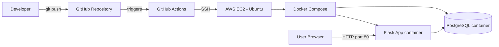
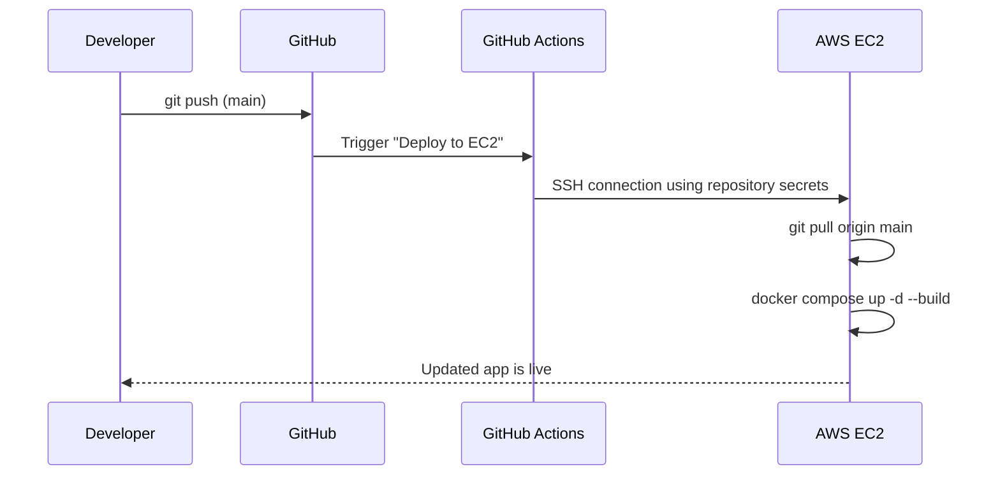
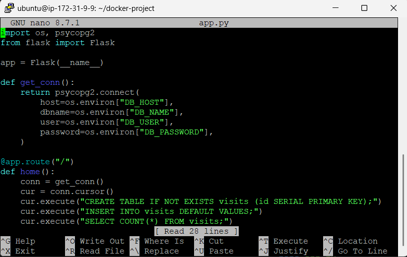
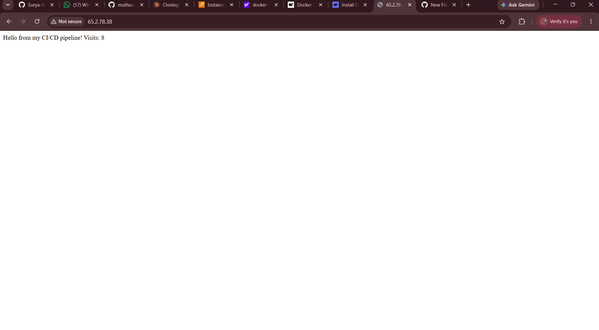

# AWS Docker CI/CD Project

A containerized **Flask + PostgreSQL** web application deployed on **AWS EC2** with **Docker Compose**, and automatically redeployed on every push using a **GitHub Actions** CI/CD pipeline.

## Overview

Every `git push` to the `main` branch triggers a workflow that connects to the EC2 server over SSH, pulls the latest code and rebuilds the containers, so the live site updates with no manual steps.

## Architecture



## Tech Stack

| Area | Tools |
|---|---|
| Cloud | AWS EC2 (Ubuntu), Security Groups |
| Containers | Docker, Docker Compose |
| Backend | Python, Flask |
| Database | PostgreSQL 16 (persistent volume) |
| CI/CD | GitHub Actions |
| Version control | Git, GitHub |

## Project Structure

```
Docker-project/
├── app.py                  # Flask application
├── requirements.txt        # Python dependencies
├── Dockerfile              # Builds the app image
├── docker-compose.yml      # App + PostgreSQL services
├── .env                    # Secrets (not committed)
├── .gitignore
└── .github/
    └── workflows/
        └── deploy.yml      # CI/CD pipeline
```

## How It Works

1. The Flask app connects to PostgreSQL using environment variables.
2. Each visit to `/` adds a row to a `visits` table and shows the total count.
3. PostgreSQL data is stored in a Docker volume, so it survives restarts.
4. The database port is not exposed to the internet. Only the app container can reach it.

## Run Locally

Prerequisites: Docker and Docker Compose.

```bash
git clone https://github.com/Surya-3018/Docker-project.git
cd Docker-project
echo "DB_PASSWORD=<choose-a-password>" > .env
docker compose up -d --build
curl http://localhost
```

Expected output:

```
Hello from my CI/CD pipeline! Visits: 1
```

## Deploy on AWS EC2

1. Launch an Ubuntu EC2 instance and open ports **22 (SSH)** and **80 (HTTP)** in the security group.
2. Install Docker and Git:
   ```bash
   sudo apt update
   sudo apt install -y docker.io docker-compose-v2 git
   sudo usermod -aG docker $USER
   ```
3. Clone the repo, create the `.env` file and start the app:
   ```bash
   git clone https://github.com/Surya-3018/Docker-project.git
   cd Docker-project
   echo "DB_PASSWORD=<choose-a-password>" > .env
   docker compose up -d --build
   ```
4. Open `http://<EC2-public-IP>` in a browser.

## CI/CD Workflow

File: `.github/workflows/deploy.yml`



### Required GitHub Secrets

| Secret | Description |
|---|---|
| `EC2_HOST` | Public IP of the EC2 server |
| `EC2_USER` | SSH user (`ubuntu`) |
| `EC2_KEY` | Private SSH key used by the workflow |

## Security Practices

- Database password stored in `.env`, excluded from Git by `.gitignore`
- PostgreSQL port is not published to the host
- SSH key stored as an encrypted GitHub secret
- Restrict the security group to SSH (22) and HTTP (80) only

## Screenshots

### 1. Editing the application code
Updating the Flask app on the EC2 server.



### 2. Pushing to GitHub
`git push` sends the commit to GitHub and triggers the GitHub Actions deployment.


### 3. Live application
The updated app, running on AWS EC2 with Docker Compose and PostgreSQL.



## Future Improvements

- Move the database to Amazon RDS
- Push images to Amazon ECR
- Provision infrastructure with Terraform
- Add HTTPS with Nginx and Let's Encrypt
- Add monitoring with CloudWatch

## Author

**<Your Name>**: AWS Cloud and DevOps
GitHub: [Surya-3018](https://github.com/Surya-3018)
